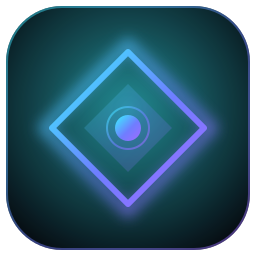
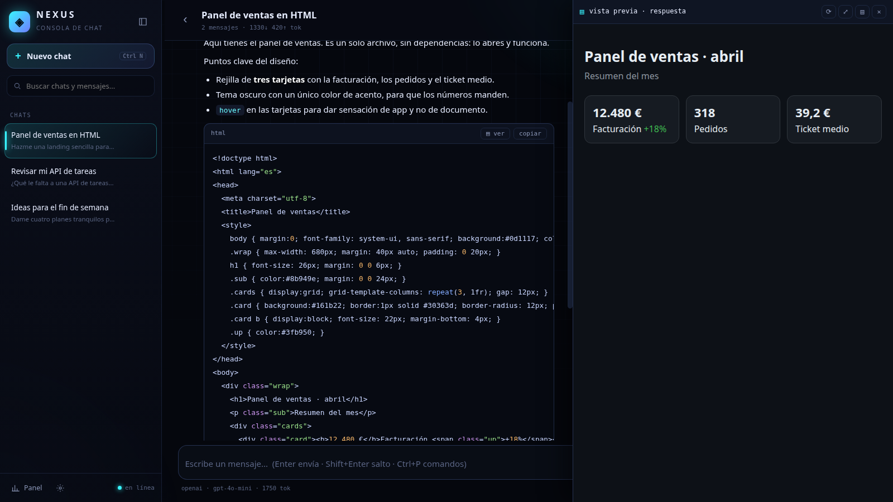
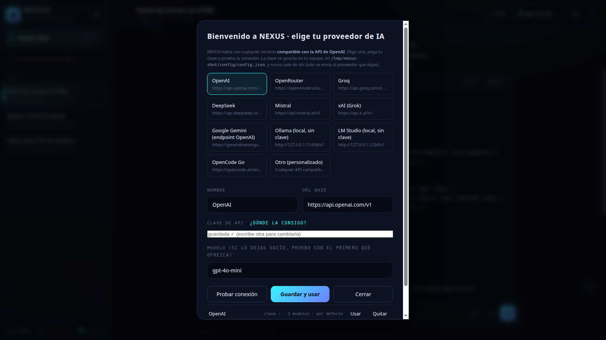
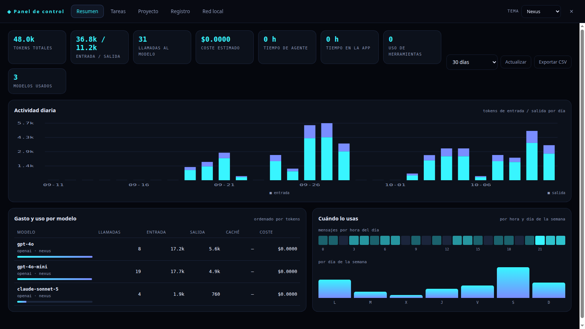
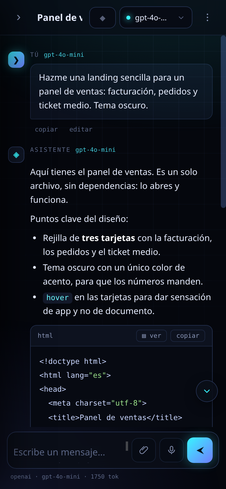

<p align="center">
  <a href="README.md">English</a> | <a href="README_zh.md">中文</a> | <a href="README_ja.md">日本語</a> | <a href="README_ko.md">한국어</a> | <a href="README_ar.md">العربية</a> | <a href="README_es.md">Español</a> | <b>Bahasa Indonesia</b>
</p>

<p align="center">
  
</p>

<h1 align="center">NEXUS</h1>

<p align="center">
  Konsol chat AI desktop yang Anda jalankan sendiri. <b>Tanpa dependensi</b>, semua penyedia yang kompatibel dengan OpenAI, dan semuanya tetap di komputer Anda.
</p>

<p align="center">
  
  
  
  
  <a href="LICENSE"></a>
</p>

<p align="center">
  <a href="#-mulai-cepat">Mulai cepat</a> &nbsp;&middot;&nbsp;
  <a href="#-fitur">Fitur</a> &nbsp;&middot;&nbsp;
  <a href="#-tangkapan-layar">Tangkapan layar</a> &nbsp;&middot;&nbsp;
  <a href="#-panel-kendali">Panel kendali</a> &nbsp;&middot;&nbsp;
  <a href="#-penyedia">Penyedia</a> &nbsp;&middot;&nbsp;
  <a href="#-model-lokal">Model lokal</a> &nbsp;&middot;&nbsp;
  <a href="#-mode-agen">Mode agen</a> &nbsp;&middot;&nbsp;
  <a href="#-jaringan-lokal">Jaringan lokal</a> &nbsp;&middot;&nbsp;
  <a href="#-pintasan">Pintasan</a> &nbsp;&middot;&nbsp;
  <a href="#-struktur">Struktur</a>
</p>

---

NEXUS adalah konsol chat yang Anda jalankan sendiri: banyak chat, banyak penyedia, riwayat permanen, streaming,
lampiran berkas dan gambar, panel pratinjau kode bergaya *artifacts*, serta dasbor pemakaian dan biaya Anda yang sebenarnya.

Bekerja dengan **layanan apa pun yang kompatibel dengan API OpenAI** (OpenAI, OpenRouter, Groq, DeepSeek, Mistral, xAI,
Gemini, Ollama dan LM Studio lokal…). Anda memilih penyedia dan menempelkan kunci di dalam aplikasi, tanpa menyunting berkas.

Tidak ada yang keluar dari komputer Anda: backend hanya mendengarkan di `127.0.0.1` dan satu-satunya koneksi keluar
adalah permintaan ke penyedia yang Anda pilih.

## 🚀 Mulai cepat

```bash
git clone https://github.com/euphoriabot7/nexus.git
cd nexus
python3 server.py
```

Buka <http://127.0.0.1:8765> dan panduan pertama kali akan meminta penyedia serta kunci Anda. **Tidak ada dependensi
yang perlu dipasang** (cukup Python 3.9+, semuanya pustaka standar).

Ingin jendela sendiri (tanpa bilah peramban) dan entri di menu?

```bash
bash run.sh              # menjalankan backend dan membuka jendela chromium --app
bash install-desktop.sh  # membuat pintasan di menu aplikasi dan desktop
bash stop.sh             # menghentikan backend
```

## ⚡ Fitur

- Banyak chat: cari, pin, ganti nama, duplikat, kosongkan, hapus, ekspor.
- Model per chat, favorit ★, dan pencarian pada daftar model penyedia.
- Riwayat permanen di SQLite; tidak hilang saat ditutup.
- Streaming token demi token, metrik (token, latensi), hentikan dan buat ulang.
- **Sunting dan kirim ulang** pesan Anda.
- **Lampiran**: seret, tempel, atau tombol 📎 (teks dan gambar).
- **Pratinjau kode**: bila balasan memuat HTML/CSS/JS, panel samping merender hasilnya **saat sedang ditulis**,
  atau kartu “Lihat hasil” di bawah pesan. Berkas yang ditulis agen tampil dengan cara yang sama. Bisa dimatikan.
- **Pencarian global** di semua pesan, dengan sorotan dan lompat ke pesan.
- **Templat prompt**, **palet perintah** (Ctrl+P), dikte suara dan baca nyaring.
- Statistik per chat, notifikasi dan suara saat selesai, 6 warna aksen, impor/ekspor JSON.
- **Antarmuka dalam 7 bahasa** (Inggris, Spanyol, Mandarin, Jepang, Korea, Arab, Indonesia), bisa diganti dari bilah atas; bahasa Arab membalik tata letak.
- **Lampiran menetap** — gambar atau dokumen yang dikirim tersimpan bersama percakapan (thumbnail atau kartu file, klik untuk membuka/mengunduh), tetap ada setelah muat ulang dan dikirim ulang saat membuat ulang.

## 🖼 Tangkapan layar

<p align="center">
  
  <br><sub>Chat dengan panel pratinjau langsung di kanan</sub>
</p>
<p align="center">
  
  <br><sub>Panduan pertama kali: pilih penyedia, tempel kunci, uji</sub>
</p>
<p align="center">
  
  <br><sub>Panel kendali: pemakaian, biaya, aktivitas harian, tabel per model</sub>
</p>
<p align="center">
  
  <br><sub>Tampilan ponsel, aplikasi yang sama lewat jaringan lokal</sub>
</p>

## 📊 Panel kendali

Tombol **Panel** (kiri bawah) atau **Ctrl+D**. Lima tab:

**Ringkasan** — token masuk/keluar, jumlah panggilan, perkiraan biaya, pemakaian alat, grafik aktivitas harian,
  tabel per model, dan peta panas per jam dan hari. Rentang 7 / 30 / 90 hari / 1 tahun serta **ekspor CSV**.
**Tugas** — serahkan pekerjaan ke agen di latar belakang (judul, perintah, folder, alat, model) dan pantau status,
  keluaran, serta token secara langsung. Perlu mode agen.
**Proyek** — penjelajah berkas dengan **pratinjau**: `.html` dirender langsung (termasuk CSS/JS relatifnya), gambar
  ditampilkan, kode sebagai teks.
**Log** — riwayat aktivitas (chat dibuat, giliran chat/agen, tugas, sesi aplikasi) dengan filter jenis.
**Jaringan lokal** — alamat untuk membukanya dari ponsel atau komputer lain, beserta tokennya.

## 🔑 Penyedia dan kunci Anda

Saat pertama kali, atau dari **Pengaturan → Penyedia dan kunci**, pilih penyedia, tempel kunci, lalu tekan **Uji koneksi**.
Aplikasi mengambil daftar model asli dari penyedia dan melakukan satu panggilan minimal untuk memastikan berfungsi.

Konfigurasinya disimpan di komputer Anda dan hanya Anda yang bisa membacanya:

```
~/.config/nexus/config.json      (0600)
```

```json
{ "default": { "provider": "openai", "model": "gpt-4o-mini" },
  "providers": { "openai": { "base_url": "https://api.openai.com/v1", "api_key": "sk-..." } } }
```

Variabel lingkungan biasa juga berlaku (`OPENAI_API_KEY`, `OPENROUTER_API_KEY`, `GROQ_API_KEY`, `DEEPSEEK_API_KEY`…).
Katalog contoh ada di `providers.json`; Anda bisa menambahkan layanan lain dengan base URL-nya
(LiteLLM, vLLM, gerbang sendiri, `http://127.0.0.1:11434/v1` untuk Ollama…).

## 🧩 Model lokal (tanpa kunci API)

Tanpa kunci API? NEXUS dapat menjalankan **model lokal** di komputer Anda sendiri: tanpa akun, tanpa biaya, dan tanpa
ada yang keluar dari komputer setelah diunduh. Ia mengurus semuanya: mendeteksi dan memasang **[Ollama](https://ollama.com)**
(atau **[LM Studio](https://lmstudio.ai)**), mengunduh model dengan bilah progres, dan menyiapkan penyedia
agar Anda bisa langsung mengobrol dengannya.

Buka 🧩 di bilah atas, atau *Pengaturan → Model lokal*.

**Dua jalur:**

- **Ollama** (disarankan): NEXUS memasangnya (Linux: skrip resmi dengan kata sandi Anda; **Windows**: mengunduh dan menjalankan
  `OllamaSetup.exe`; macOS: unduhan resmi) lalu mengambil model yang Anda pilih.
- **LM Studio**: NEXUS mendeteksinya, menjalankan server lokalnya, dan dapat mengunduh model dengan perintah `lms`. Setiap kartu
  memberi tahu repositori Hugging Face yang digunakannya.

**Katalognya** (35 model, semuanya 3 GB atau kurang, dengan ukuran yang diverifikasi terhadap registri Ollama yang sebenarnya dan
berkas Hugging Face) dirancang untuk komputer ringan dan menekankan model **tanpa sensor** (Dolphin dan
yang *abliterated*), dengan catatan jujur di setiap kartu tentang apa yang bisa dan tidak bisa dilakukannya:

| Model | Ukuran | Tanpa sensor | Alat |
|---|---|---|---|
| Qwen2.5 0.5B abliterated | 379 MB | ya | tidak |
| TinyDolphin 1.1B (Q4/Q6) | 637 MB / 862 MB | ya | tidak |
| Dolphin 3.0 Llama 3.2 1B (Q4) ᴴᶠ | 770 MB | ya | tidak |
| Llama 3.2 1B abliterated | 911 MB | ya | tidak |
| Qwen2.5 1.5B abliterated | 940 MB | ya | tidak |
| Qwen3 1.7B abliterated | 1,06 GB | ya | tidak |
| Qwen2.5 Coder 1.5B abliterated | 1,07 GB | ya | tidak |
| Dolphin Phi 2.7B (Q2/Q4) | 1,12 / 1,53 GB | ya | tidak |
| StableLM Zephyr 3B | 1,53 GB | permisif | tidak |
| Dolphin 3.0 Llama 3.2 3B (Q3) ᴴᶠ | 1,61 GB | ya | tidak |
| Qwen2.5 / Qwen2.5-Coder 3B abliterated | 1,84 GB | ya | tidak |
| Dolphin 3.0 Qwen2.5 3B (Q4/Q5) ᴴᶠ | 1,84 / 2,12 GB | ya | tidak |
| Dolphin 3.0 Llama 3.2 3B (Q4/Q5) ᴴᶠ | 1,93 / 2,22 GB | ya | tidak |
| Hermes 3 Llama 3.2 3B ᴴᶠ · Ollama | 1,93 GB | permisif | **ya** |
| Llama 3.2 3B abliterated | 2,14 GB | ya | tidak |
| Qwen3 4B · Qwen3 1.7B | 2,38 / 1,30 GB | tidak | **ya** |
| Spark X2.5 4B heretic | 2,48 GB | ya | ya |
| MiniCPM5 2B heretic | 2,56 GB | ya | tidak |
| Wizard Vicuna 7B tanpa sensor (Q2) | 2,69 GB | ya | tidak |
| Dolphin Mistral 7B (Q2) · OpenHermes 2.5 7B (Q2) | 2,94 GB | ya / permisif | tidak |

ᴴᶠ = tidak ada di pustaka Ollama: diunduh dari Hugging Face (`ollama pull hf.co/pengguna/repo:Q4_K_M`), yang
dilakukan tombol Unduh untuk Anda.


**Model lokal dalam mode agen.** NEXUS menyiapkan Hermes saat pertama kali Anda memakai model lokal dalam mode
agen: mendaftarkan endpoint penyedia (`hermes config set providers.ollama.base_url …`), meminta Ollama
jendela 64k (`model.ollama_num_ctx`, minimum Hermes), dan menonaktifkan streaming untuk penyedia itu,
karena Hermes macet dengan Ollama saat mengalirkan panggilan alat. Setelah itu semuanya bergantung pada
model: **mode agen memerlukan model yang mendeklarasikan pemanggilan fungsi**, dan Anda bisa memeriksanya sendiri dengan
`ollama show <model>` (lihat `tools` di *Capabilities*). `qwen3:1.7b` (1,3 GB), `qwen3:4b`, `hermes3:3b` dan
keluarga *abliterated* dari `huihui_ai` ya; **yang diambil dari Hugging Face (`hf.co/…`) tidak** (hanya mendeklarasikan
`completion` dan Ollama menjawab *HTTP 400: does not support tools*), jadi itu hanya untuk chat. Dua peringatan:
model kecil bisa mendeklarasikan alat dan memakainya dengan buruk, dan satu giliran agen lokal berjalan di CPU Anda, jadi
lambat — dengan RAM bebas sedikit tidak cukup.
**Hanya untuk mode agen**: model lokal perlu memahami *pemanggilan fungsi* untuk menyentuh berkas atau menjalankan
perintah, dan sangat sedikit model kecil yang bisa. Kartu yang ditandai *dengan alat* (**Hermes 3 3B**,
**Qwen3 1.7B/4B**, **Spark X2.5 4B**) yang layak dicoba; sisanya untuk mengobrol, menulis, meringkas
dan menerjemahkan. Itu juga berjalan di CPU Anda, jadi lambat: untuk pekerjaan agen serius, lebih baik penyedia via API.

## ✨ Specialists (ready-made assistants)

You do not have to explain anything twice. NEXUS ships with **13 specialists**: ready-made assistants that
bring their own instructions, the tools they need, their recommended models and their starter prompts.

| Specialist | What it is for | Works as agent |
|---|---|---|
| 🗂️ **Butler of the machine** | Explores, finds, reads and sorts files on your computer | yes |
| 🧑‍💻 **Programmer** | Reads your project, changes it, runs the tests and tells you what it touched | yes |
| 📊 **Data analyst** | Turns your CSV and spreadsheets into decisions and charts | yes |
| 🧾 **Bookkeeper** | Orders invoices and expenses, works out margins and taxes | yes |
| 🔍 **SEO specialist** | Search intent, keywords, titles and structure, with the reason behind each one | no |
| ✍️ **Sales copywriter** | Ads, product pages and emails with conversion structure | no |
| 📣 **Social media** | A whole month of posts planned in one session | no |
| 📜 **Contract reviewer** | Explains in plain words what you are signing, and what to ask before signing | no |
| 🎓 **Tutor** | Teaches you from your own notes and checks that you understood | no |
| 🎧 **Customer support** | Short, human replies to complaints and returns | no |
| 🌍 **Translator** | Translates and adapts the tone to each market | no |
| 🧭 **Business consultant** | Three options with cost, risk and what he would do with his own money | no |
| 🏠 **Everyday helper** | Errands, lists, emails and plans, without lectures | no |

Open the **✨** button in the top bar. Each card has **Start** (it opens a chat already set up), **Edit** and
**Delete**, and you can create your own specialist with the form at the bottom: name, hook, instructions, tools,
local and cloud model, and its starter prompts. The starter prompts show up as buttons above the text box, so
you never stare at an empty screen.

**First contact, in one click.** The first card offers *Set up and start*: NEXUS installs Ollama if you do not
have it, downloads the lightest uncensored model that also knows how to use tools, leaves the provider
configured and opens the chat with the butler. Nothing to configure by hand and no API key.

## 🤖 Mode agen (opsional)

Dalam **mode agen** NEXUS menjalankan [Hermes](https://hermes-agent.nousresearch.com) dengan alat sungguhan: membaca dan menulis
berkas, menjalankan perintah, dan menjelajah. Bila belum terpasang, aplikasi menawarkan memasangnya lewat tombol di panduan
(`Pengaturan → Penyedia dan kunci → Mode agen`). Tanpa Hermes, NEXUS tetap berfungsi sama; tombol agen hanya disembunyikan.

Ganti mode dengan pil **Chat / Agent** di bilah atas. Mode chat adalah jawaban langsung dari model; lampiran
(berkas teks dan gambar) dikirim ke model, dan gambar memerlukan model dengan kemampuan visi.

## 📱 Akses jaringan lokal (ponsel, tablet, komputer lain)

Server mendengarkan di seluruh jaringan (`0.0.0.0`). Dari luar komputer ini Anda memerlukan **token** yang tampil di
Panel → Jaringan lokal:

```
http://IP_ANDA:8765/login?token=TOKEN_ANDA
```

Itu menyimpan cookie dan tidak akan diminta lagi. Tanpa token, permintaan eksternal menjawab **401**.
Untuk mematikan akses jaringan: `NEXUS_LAN=0 python3 server.py`. Di Linux dengan ufw, `sudo bash lan-allow.sh` membuka port untuk subnet Anda.

Di ponsel aplikasi otomatis beralih ke tata letak seluler: riwayat berbentuk laci, kontrol lebih besar, sheet bawah, dan
area aman. Tips: di Chrome, *⋮ → Tambahkan ke layar utama* agar tampil penuh layar.

## ⌨ Pintasan

```text
    Ctrl+N     chat baru             Ctrl+P    palet perintah
    Ctrl+K     ganti model           Ctrl+F    cari chat dan pesan
    Ctrl+D     panel kendali         Ctrl+B    tampilkan/sembunyikan riwayat
    Alt+↑ / ↓  chat sebelumnya / berikutnya
    Alt+1…9    lompat ke chat nomor n
    Enter      kirim (Shift+Enter = baris baru)
    ?          bantuan pintasan      Esc       tutup jendela, hentikan bacaan
```

## 🗂 Struktur

```text
    nexus/
      server.py            backend (hanya pustaka standar Python)
      providers.json       katalog penyedia contoh
      prompts.json         pustaka prompt contoh (25)
      app/                 antarmuka (HTML + CSS + JS, tanpa dependensi)
      assets/shots/        tangkapan layar untuk README ini
      run.sh / stop.sh     menjalankan dan menghentikan
      install-desktop.sh   pintasan menu dan desktop
      lan-allow.sh         membuka port di ufw (opsional)

    ~/.config/nexus/config.json        penyedia, kunci, dan model bawaan
    ~/.config/nexus/models_cache.json  daftar model dari penyedia
    ~/.local/share/nexus/nexus.db      chat, pesan, dan templat (SQLite)
    ~/.local/share/nexus/server.log    log backend

Variabel lingkungan: `NEXUS_PORT` (8765), `NEXUS_DATA`, `NEXUS_CONFIG_DIR`, `NEXUS_LAN=0`.
```

## 📝 Catatan

- Kunci **tidak** ada di repositori: tersimpan di komputer Anda (`~/.config/nexus/config.json`, mode 0600) atau variabel lingkungan.
- Mode agen menjalankan perintah di folder kerja chat: itu komputer Anda sendiri, gunakan dengan hati-hati.
- Memerlukan Python 3.9+ dan peramban. Diuji di Linux (Mint/Ubuntu); di macOS dan Windows/WSL sama saja
    (di sana jalankan `python3 server.py` dan buka peramban sendiri).
- Antarmuka tersedia dalam **7 bahasa** (Inggris, Spanyol, Mandarin, Jepang, Korea, Arab, dan Indonesia); ubah dari bilah atas atau Pengaturan. Bahasa Arab juga membalik tata letak ke kanan-ke-kiri.

## 📄 Lisensi

MIT — lihat [LICENSE](LICENSE).
